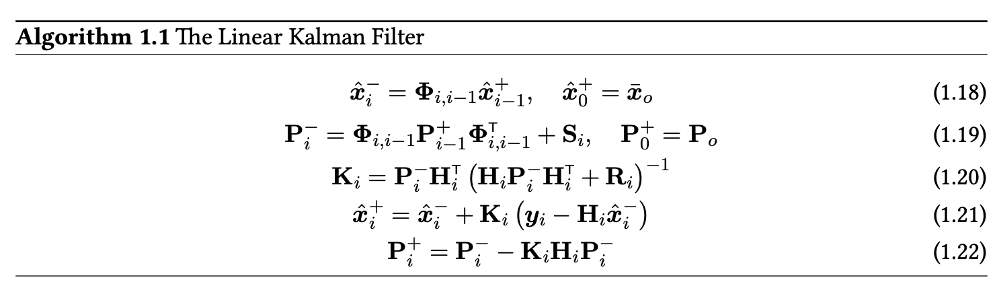
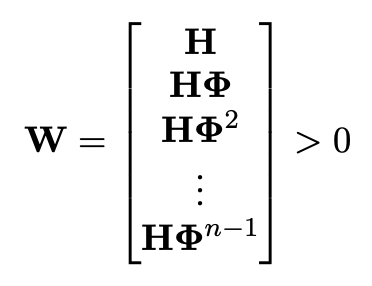
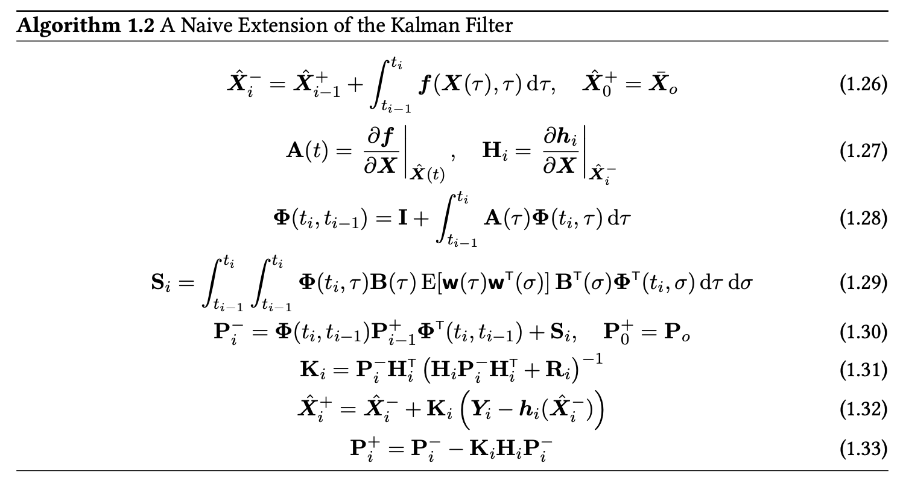
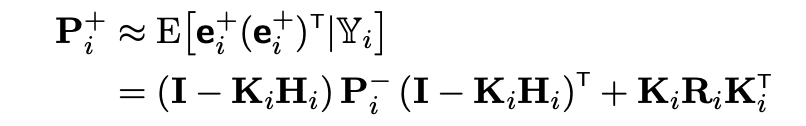

# EKF

## Additive EKF
### Dynamics Model
- State vector and dynamics function
- Process noise `w(t)` for uncertainty in dynamics

Derivation
- With `dX = f(X,t)*dt + B*dW` but same as `X = f(X,t) + B*W` 
- Mean $X_0$ and covariance $P_0$ given by expected value formula
- Process noise covariance $Q(t)$ (power spectral density)
  - Also from expected value formula
- Initial values are assumed to be Gaussian
- $X$ is **not** assumed to be Gaussian (since function may not be)

### Measurement Model
- What we expect to see given the estimated state
- `Y = h(X,t) + v` -> `Y = h(X) + v` (compactness)
- Measurement noise also from expected value formula
- Cannot assume $Y$ is Gaussian (since function $h$ may not be)

### Linear Kalman Filter

- If observability Grammian full rank then covariance reaches steady state
 
- Want to keep covariance $P$ positive definite

### Extended Kalman Filter

- Joseph's form holds for NON optimal gains

- In general, still want $P$ positive definite
  - Eigenvalue of 0 means no uncertainty (which is false)

### MEKF
- Can have attitude corrections with small-angle rotations