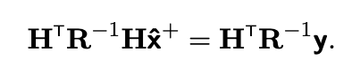
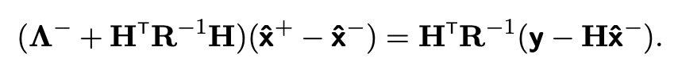
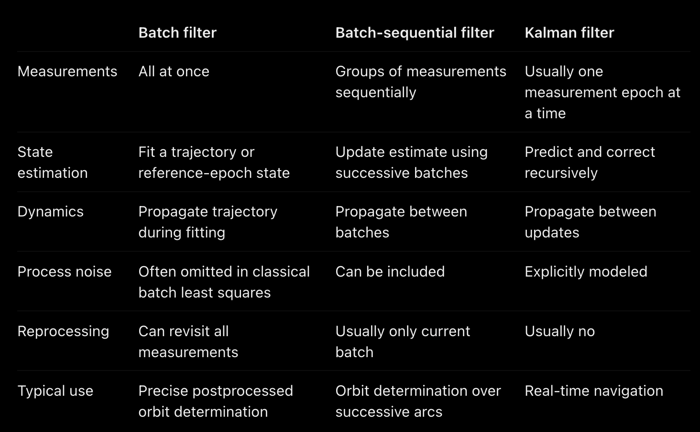

# Batch Sequential Filters
- Improved computational efficiency than sequential processing

## Batch and Batch-Sequential Filters
- Can solve via
  - 
- Assuming *a priori* information 
- New "weighting" matrix $\Lambda$ (large eigenvalues are GOOD)
- 
  - Can estimate if information matrix (thing on the left left) is invertible
- In nonlinear form use Jacobians and stuff
- Accumulated measurements can be referenced back to estimated params at start (outdated, talked about later)

## Onboard Nav using Batch-Sequential Filters
- In case ground-based nav is not good
- Flown on `Deep Space 1`, `Stardust`, and `Deep Impact`

### `Deep Space 1`
- Imaging beacon asteroids for 2D position fix
- Used with least-squares filter for orbit determination
- Dynamical model included n-body, SRP, thrust, accel bias
- Heliocentric propagation with 7-8th order RK
- Only **METERS** of error in **MONTHS**
  - Below sensing ability of optical data
- Calculating Solutions
  - Linearize around nominal trajectory
  - Estiamte corrections in weighted-least-squares sense
  - U-D covariance factorization
- Initially batch processor
  - 12-16 images for orbital determination once per week
  - AutoNav "woke up" when bursts were available, only after about 4 weeks
- No covariances carried over (for constraining solution)
- Data Editing
  - Outliers past 2.5-3 s.d.
  - Data reprocessed every week

### `Deep Impact`
- Needed to calculate impact onboard
  - Mainly ground for cruising until 2 hours before
- Process
  - 15s increments
  - Bad data removed, and only filtering after 10 minutes
  - Cutoff for resid over set pixel amount (outgassing, stray light)
  - Moving window of 20m data arc
- Used to compute T-90, -30, -12 maneuvers
- On flyby spacecraft too for tracking nucleus

### General best practice
- Moving data arc window
- Open a priori covariance
- Conditions
  - Infrequent data
  - Slow dynamics
  - Highly unknown characteristics of observed bodies

### Reduced State Encounter Navigation (RSEN)
- Tens of minutes surrounding flyby
- Originally KF but there is bad data
- Braille flyby had bad initial first estimate though
- 3-at-a-time window checking
- 10m before encounter, still use all accumulated data

### Landing on Mars
- Terminal Descent Sensor (TDS) by Mars Science laboratory (MSL)
  - range and velocity meas
- Make robust filter rather than worry about sensor accuracy
- Extensive TDS characterization
- Ambiguity resolution failure could lead to 40 m/s error for some measurements
  - Handled by filter though
- Filter
  - 3 filters
  - 20-some minimally checked measurements
  - Sliding-window (3 different fixed-lengths before rover detachment, fixed-epoch after)
  - 1 filter for velocity estimate, 2 for altitude
    - Altitude in buffer, mean used for control system
  - Finite recursive editing steps to remove velocity outliers (in case debris)
  - Unique parameters for each stage of the landing process
