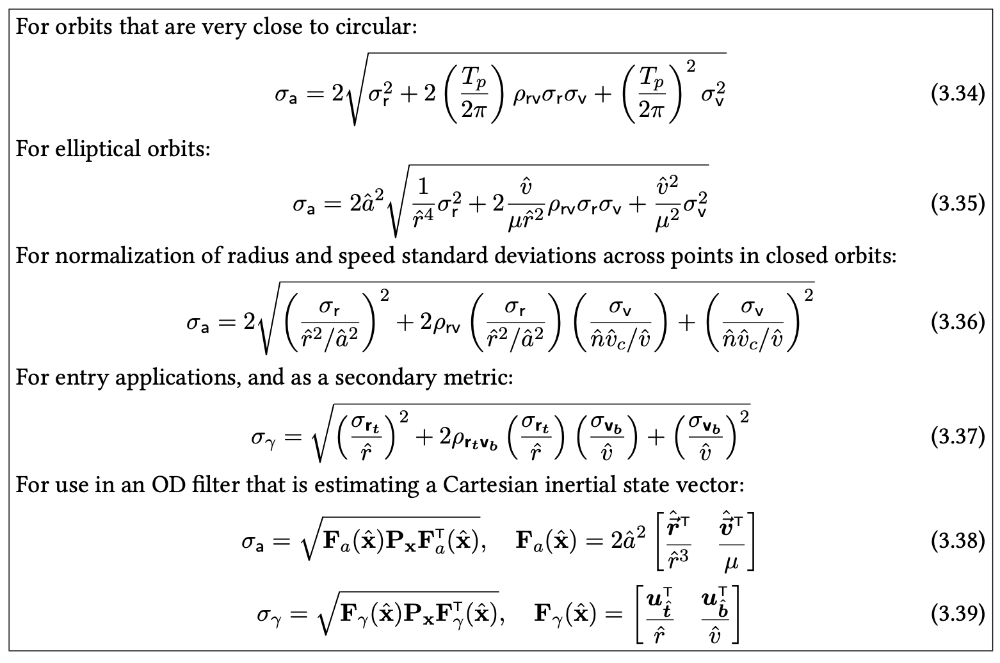
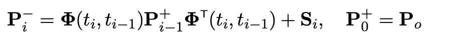
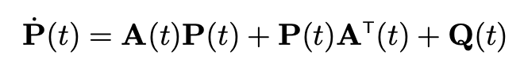
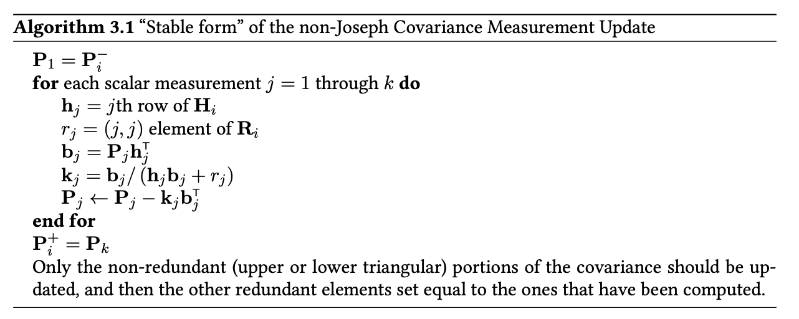

# Covariance Matrix

## Metrics 
- Root sum squred (RSS) / square root of trace
  - Need scaling
- Orbit error dominated by semi-major axis (SMA) error
  - Important for rendezvous and formation flying
- SMA from vis-a-vis, so $r$ and $v$ need good approximations
  - BUT need to be well balanced
- e.g. flight-path angle error
- **Best Practice**: Use SMA s.d. as metric

## Propagation
Discussing best practices for 

Need suitable approximation for state transition matrix
### Riccati Equation!

### State Transition Matrix
- Common in ground-based OD
- Simultaneously integrate STM and state vector
- Different ways of integrating (Taylor, RK, etc.)

### Process Noise Covariance

TODO

