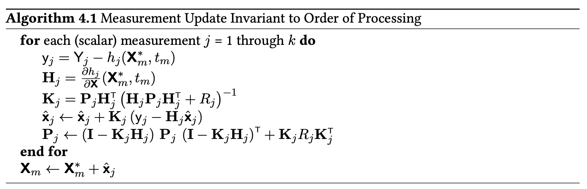

# Processing Measurements
- Asynchronous or invalid order

## Measurement Latency
- $\Delta t$ latency not insignificant
- Use previous measurement to correct current state estimate
- Process
  - Given: $x_k^-$, latent $y_m$ taken at m but received at k
  - Use STM to relate $x_k^-$ to prev $x_m$
  - Calculate $r_m$ and $H_m$ 
  - Use STM to relate $H_m$ to $\tilde{H_m}$ ($H_k$ ish)
  - Use that to correct $x_k^+$

## Measurement Order
- Estimate dependent on order of measurements (IMU, barometer, etc.)
- Could wait until all measurements are processed

## Vector Measurements
- Can keep vectors correlated
  - Other option is all 3 scalars, but they are correlated
- Transform measurement space
  - Noise covariance is identity
  - Changes measurement, residual, noise
- Choices
  - Cholesky, use $R_i^{-1/2}$
  - U-D use $U_i^{-1/2}$

## Filter Cascades
- Cascading filter outputs into inputs
- Inconsistency or divergence
  - time-correlated errors
- Measurements might not provide independent information from previous filter over time
  - Could double-count information
  - Violates that measurement noise is white
- Fixes
  - Add exponentially correlated random variable states 
    - Estimate the error too
  - Better characterization of cascading

## Inertial Sensors
- MODEL REPLACEMENT MODE
  - Similar to complementary filtering
  - Fed forward as deterministic inputs to dynamics
  - Estimate biases 
  - Thresholding to avoid unfiltered IMU noise