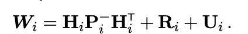
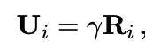
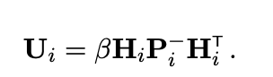
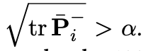
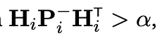
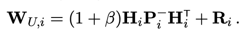
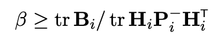

# Measurement Underweighing
- Ad-hoc technique to compensate for nonlinearities 
  - Space Shuttle, Artemis, etc.
  - Increasing noise covariance by constant amount
- Standard KF leads to overconfident estimate when hasn't converged in reality
  - e.g. confident on x=3 when it is actually 5
  - Causes it to ignore new measurements
- Underweighing slows convergence of state estimate error covariance

## Nonlinear Effects and the Need for Underweighing
### State estimate update approaches
- Linear Kalman Filter
  - Optimal blending of $\hat{x}_i^-$ and $y_i$ to get $\hat{x}_i^+$
  - Covariance based off of error
    - $e_i^- = x_i - \hat{x}_i^-$
    - $e_i^+ = x_i - \hat{x}_i^+$
    - $P_i^- = E\left[e_i^- (e_i^- )^T \right]$
    - $P_i^+ = E\left[e_i^+ (e_i^+ )^T \right]$
  - Use Joseph formula applicable any K
    - Minimize trace with optimal K
    - Under assumptions (importantly linear) estimation error converges and P positive definite
- Nonlinear EKF
  - Taylor series approximation of nonlinear function
  - Want to keep error covariance consistent with actual errors
  - If P is large then HPH' is approximately R
- Nonlinear 2nd order KF update
  - Standard EKF underestimates uncertainty (ignores 2nd order measurement nonlinearities)
  - $B$ additional in the innovation/residual covariance for curvature causes
  - Problem: large covariance with nonlinearity 

## Underweighing
- Nonlinear BUT precise prior
  - Rely on prior more
  - Hessian might be large but P is small so second order effects small
- Underweighing modifies residual covariance

### Additive Compensation
- Factor $U$ is added to residual covariance
- 
- One choice is to make it equal to $B$ from the second order effects
- Higher computational cost due to 2nd order partials and ASSUMPTION that estimation errors are Gaussian
- $U$ needing to be tuned :(

### Scaling Measurement Covariance
- $U$ is scaled from $R$
- 
- NOT recommended
  - Since underweighing helps with 2nd order terms, those are obtained via a priori
  - $U$ being constant w.r.t $R$ is less practical and does not obey that

### Lear's Method
- $U$ is scaled from $H\ P\ H^T$
- 
- Have $\bar{P}^{^-}$is partition of P with position error states
  - Space shuttle underweighs when  
  - 
  - with $\alpha = 1000$m and $\beta = 0.2$ (if condition is satisfied, else 0)
  - Orion when
  - 

### Pre-Flight Tuning Aids
- Lears: 
- When comparing the above to formula with B choose $\beta$ s.t. 
- Tuned in sims